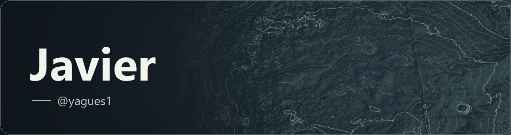
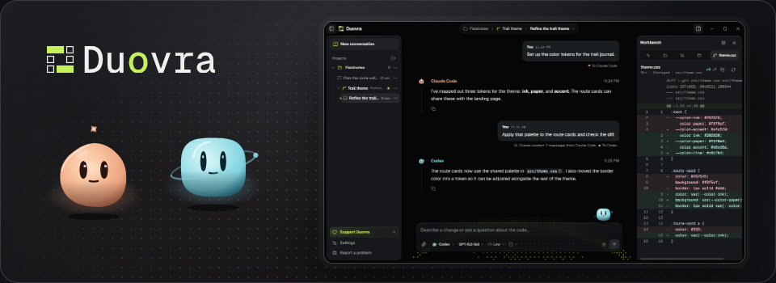
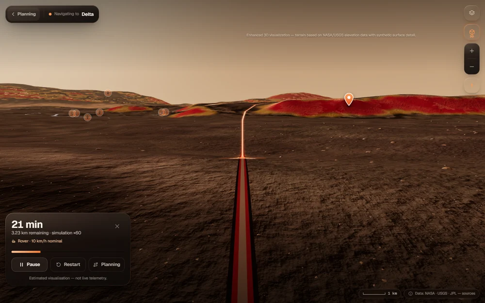

<h1></h1>

I’m an independent developer and a Computer Engineering student. I’m interested in artificial intelligence, cybersecurity, building products and open-source software.

## Projects

### Duovra

I’m building an open-source Windows workspace for Claude Code and OpenAI Codex. It brings both agents into the same conversation, with Git worktrees, Live Preview and a Workbench for reviewing code.

[Repository](https://github.com/yagues1/duovra) · [Official website](https://duovra.vercel.app/en) · [Windows releases](https://github.com/yagues1/duovra/releases/latest)

### GeoMars

A NASA Space Apps team project for exploring Jezero Crater on Mars. The web app combines NASA and USGS data with terrain-aware route planning and a simulated traverse.

[Repository](https://github.com/yagues1/GeoMars) · [Technical design report](https://github.com/yagues1/GeoMars/blob/main/docs/GEOMARS_Martian_Map_Technical_Design_Report_Improved.pdf)

## Tools I use

`TypeScript` · `React` · `Rust` · `Tauri` · `Git` · `Python` · `MapLibre GL JS`

## Links

[GitHub projects](https://github.com/yagues1?tab=repositories) · [Duovra website](https://duovra.vercel.app/en)
